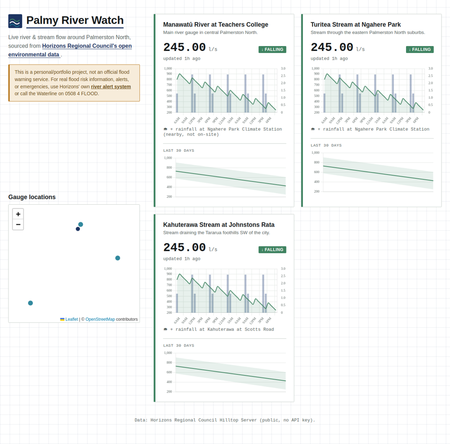

Full-stack app built on
[Horizons Regional Council's public environmental data](https://www.horizons.govt.nz/environment/natural-hazards-and-flood-management/environmental-data-at-horizons)

Current screenshot of basic GUI in progress


Backend:
  This app uses python + FastAPI + SQLite to poll the Horizons' Hilltop Server in
  the background. It then stores local history over time so you can view trends.

Frontend:
  Plain HTML/CSS/JS, Chart.js, and Leaflet (WIP)


Areas being measured in sites.py:
- Manawatū River at Teachers College 
- Turitea Stream at Ngahere Park 
- Kahuterawa Stream at Johnstons Rata 


## How to run the app (locally only currently)
Both frontend and backend need to run in two separate bash tabs at the same time.

### 1. Backend

In Linux bash:
```
cd backend

python3 -m venv .venv && source .venv/bin/activate  

pip install -r requirements.txt

cp .env.example .env   # then edit .env and set a real ADMIN_API_KEY (see steps below)

uvicorn main:app --reload --port 8000 # or whatever port number is open for you
```

After the above prerequisites have been installed, you can check its live by opening localhost:/8000/api/sites.


### 2. Frontend

In Linux bash:

```bash

cd frontend

python3 -m http.server 5500 # or whatever port number not used by backend

```
Once the server is running you can open http://localhost:5500 in your browser. 


## API endpoints

| `GET /api/sites` | The configured sites |
| `GET /api/sites/{key}/data?hours=48` | Recent and latest data readings, trends, and rainfall (if configured) from the local SQLite storage |
| `GET /api/sites/{key}/stats?days=7` | Min, max, avg, or count over N days |
| `GET /api/sites/{key}/daily?days=30` | The daily min/max/avg summary |
| `POST /api/admin/poll-now`  | Manually triggers a poll (this skips the 15-min wait) |
| `GET /api/debug/raw/{key}`  | Raw Hilltop XML response for debugging or troubleshooting |

The last two apis (poll-now, raw) both require an `X-API-Key` header. Everything else is left open, currently the only endpoints
worth gating are those two.

### Setting up the admin key

```bash

cp backend/.env.example backend/.env

python3 -c "import secrets; print(secrets.token_urlsafe(32))"  # generates secret key
# paste it into backend/.env as ADMIN_API_KEY=keyhere

```


## Data source 

All environmental data is sourced live from Horizons Regional Council's
Hilltop Server (`hilltopserver.horizons.govt.nz`), made publicly available
by the council. This project is not affiliated with or endorsed by
Horizons Regional Council.

Map tiles © [OpenStreetMap](https://www.openstreetmap.org/copyright)
contributors, rendered with [Leaflet](https://leafletjs.com/).

## License

MIT — see [LICENSE](LICENSE).
